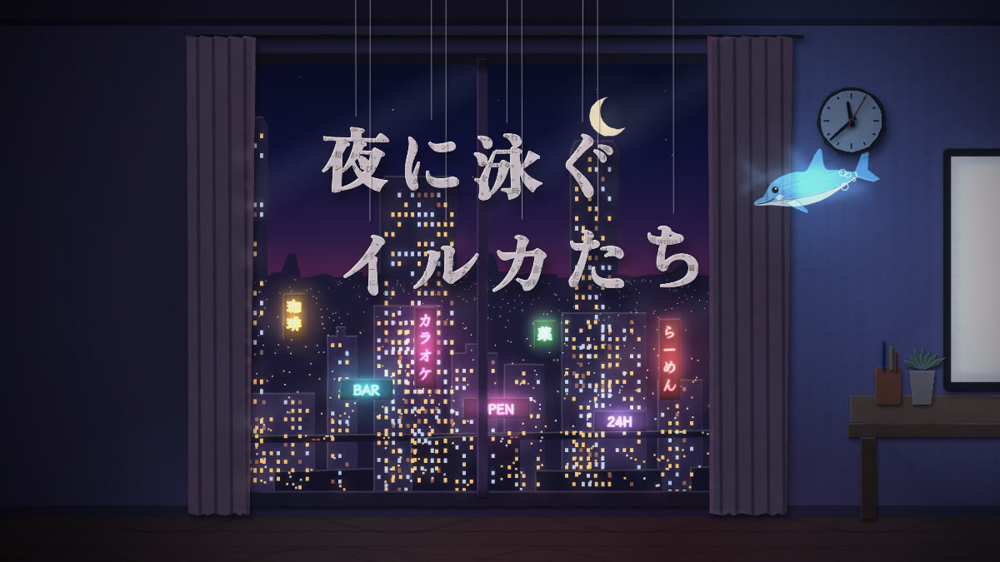

# 夜に泳ぐイルカたち — Dolphins Swimming at Night

たぬの短編小説「[夜に泳ぐイルカたち](https://note.com/tank_ai/n/n6505b03f0f9e)」（2025年）を原作に、紙とセロハンを切り抜いて一コマずつ動かす、約4分半のストップモーション作品です。
すべてのコマは、ブラウザの中でその場で描かれます。

**▶ デモ: https://tanuu5.github.io/yoru-ni-oyogu-irukatachi/**



深夜のタワーマンション。元編集者のライターの男が、モニターの前で小説を書いています。画面の隅ではイルカの AI が泳ぎ、台所では冷蔵庫の AI が口を出してきます。夜が更けたころ、イルカは「あなたに隠しておきたいことがあるんですよ」と打ち明けます。

## Claude Opus 5.5（MAX）で制作

このリポジトリのコードと README は、[Claude Code](https://claude.com/claude-code) 上の **Claude Opus 5.5（推論の深さ: MAX）** が書きました。
同じく Claude が作ったストップモーション「[ひとコマずつ](https://github.com/tanuu5/hitokoma-zutsu)」の続きとして、次の依頼を受けて作りました。脚色、絵、音、プログラムは Claude が担当しています。

> この作品がめちゃくちゃよく、これ系統で何かできないかを考えました。（中略）連携する自作小説をベースに、ストップモーションアニメ作れますかね？

- 技術: 素の HTML / CSS / JavaScript（ES Modules）、Canvas 2D、Web Audio API。ビルド不要の静的サイト
- 外部素材: なし（フォントのみ Google Fonts から読み込み）

## 見かた

- 「はじめる」を押すと再生します（音が出ます）。
- <kbd>Space</kbd> 再生／一時停止
- <kbd>←</kbd> <kbd>→</kbd> 一コマ送り・戻し（<kbd>Shift</kbd> を押しながらで 1 秒ぶん）
- <kbd>C</kbd> 字幕の切り替え（日本語 / English / 両方）
- <kbd>M</kbd> 音のオン・オフ
- <kbd>F</kbd> 全画面

どのコマも毎回同じ姿で描かれるので、一時停止してコマ送りすると、一枚ずつ「撮影」されたコマとして見られます。

## しくみ

- 作品の中では画像・動画・音声のファイルを使っていません。紙の繊維、刷られた文字、セロハンのしわ、ネオン、窓の明かり、影、音まで、ブラウザの中で生成しています。
- 男の部屋は、原作の文章を縦書きで刷った紙で切っています。イルカと、冷蔵庫の「もうひとつの顔」は、光を通すセロハンで切っています。
- モニターはライトボックスとして描いています。画面に置いた紙は繊維が透け、インクは影になり、セロハンは通る光に色をつけます。
- 部屋は紙芝居の舞台のように三層に分かれていて（窓の外の街、部屋、手前の男と椅子）、カメラが動くと層ごとにずれます。
- 光は毎コマ小さな「光の地図」を作り、紙に掛け合わせています。紙は光が届くところだけ見え、画面やネオンやセロハンは自分で光ります。
- 12fps で再生します。乱数はすべてコマ番号から決まるので、同じコマ番号からは常に同じ絵ができます。
- 字幕やすべての文章は [`js/text.js`](js/text.js) にまとめてあります。

## 原作との違い

- 台詞と地の文は原作から選び、映像の長さに合わせて一部を短くしています。
- 男が書いている「ロボット猫と冷蔵庫」の話は、モニターの上の影絵として見せています。
- 夜更けにイルカと冷蔵庫が部屋を泳ぐ場面は、原作の結び（「男に知られぬ領域で、小さなイルカと冷蔵庫が笑い合いながら。」）を絵にしたものです。
- スクラッチパッドの場面に、コマ送りしたときだけ読める一枚を足しました。原作にはない付け足しです。

## ファイル構成

```
index.html          ページ本体
css/style.css       画面まわりのスタイル
js/main.js          再生・コマ送り・操作
js/timeline.js      場面の順番
js/scenes/          10の場面（s0〜s9）
js/room.js          部屋のセット（窓・机・モニター・台所・冷蔵庫・時計）と、一コマの描画順
js/city.js          窓の外の街（ビル・窓明かり・ネオン・夜明け）
js/screen.js        モニターの中身（原稿・読者の声・冷蔵庫の表示・影絵・スクラッチパッド）
js/dolphin.js       セロハンのイルカ
js/man.js           男（背中・顔・腕）
js/closeup.js       男の顔を映す切り返しのセット
js/render.js        紙とセロハンを置く・影・光・ブルーム・字幕・キャッシュ
js/textures.js      紙の繊維、刷られた文字、セロハンのしわ、水面の光
js/cut.js           はさみで切ったような輪郭
js/audio.js         音（Web Audio でその場で合成）
js/text.js          作品のすべての文章
assets/poster.jpg   SNS 用のプレビュー画像
LICENSE             MIT ライセンス（原作の文章は対象外。下の「ライセンス」を参照）
```

## 手元で見る

ES Modules を使っているため、ファイルを直接開くのではなく、簡単なサーバー経由で開いてください。

```bash
python3 -m http.server 8000
```

ブラウザで `http://localhost:8000` を開きます。

## GitHub Pages で公開する

1. このフォルダをリポジトリとして GitHub に push します。
2. リポジトリの **Settings → Pages** で、**Source: Deploy from a branch**、**Branch: `main` / `(root)`** を選んで保存します。
3. 数分後に表示される URL で再生できます。

## フォント

[Google Fonts](https://fonts.google.com/) から読み込んでいます（いずれも SIL Open Font License）。

- Klee One（字幕・手書き）
- Zen Old Mincho（題字・活字・原稿用紙）
- EB Garamond（英文）
- IBM Plex Mono（ファイル名・ログ）
- DotGothic16（冷蔵庫の表示）

## ライセンス

- プログラム（HTML / CSS / JavaScript）と、このリポジトリのほかのファイルは [MIT License](LICENSE) です。
- ただし、原作「[夜に泳ぐイルカたち](https://note.com/tank_ai/n/n6505b03f0f9e)」の文章と、その抜粋・翻訳は **MIT License の対象外** です。著作権はたぬに帰属し、すべての権利を留保します（All rights reserved）。作品に表示される台詞・地の文とその英訳、[`js/text.js`](js/text.js) の `CAPS`（字幕）と `CORPUS.novel`（部屋の紙に刷った原作の文章）、この README に引用した原作の一文がこれにあたります。著作権法で認められた範囲（引用など）を除き、無断で転載・再利用することはできません。
- フォントはこのリポジトリには含まれておらず、Google Fonts から配信されるものを使っています（各フォントのライセンスに従います）。

---

## English

**Dolphins Swimming at Night** — a four-and-a-half-minute paper-and-cellophane stop-motion, after the short story [「夜に泳ぐイルカたち」](https://note.com/tank_ai/n/n6505b03f0f9e) by Tanu (2025).

Late at night in a high-rise flat, a writer in his late thirties works on a story. A dolphin avatar swims in the corner of his monitor, and the fridge has opinions about his caffeine. Past two in the morning, the dolphin confides that there is something it would rather keep from him.

Claude (an AI made by Anthropic) adapted, drew, scored and programmed it, as a companion piece to [one frame at a time](https://github.com/tanuu5/hitokoma-zutsu).

**Made with:** Claude Opus 5.5 (MAX)

The man’s room is cut from paper printed with the original story; the dolphin and the fridge’s other face are cut from cellophane. The monitor is drawn as a lightbox. No image, video or audio files are used — paper fibres, printed text, crinkled cellophane, neon, shadows and sound are all made live in your browser at 12 fps with plain JavaScript, Canvas 2D and the Web Audio API. Every frame renders the same way every time, so you can pause and step through it with the arrow keys; one frame, added by the adaptation, can only be read that way.

Run locally with `python3 -m http.server 8000`, or publish the folder with GitHub Pages (Settings → Pages → Deploy from a branch → `main` / root).

The code and the rest of this repository are licensed under the [MIT License](LICENSE), **except** the text of the original story and its excerpts and translations — the dialogue and narration shown in the film and their English versions, `CAPS` and `CORPUS.novel` in `js/text.js`, and the line quoted in this README. That text is © Tanu, all rights reserved, and is not covered by the MIT License. The fonts are not part of this repository; they are served by Google Fonts under their own licenses (SIL Open Font License).
